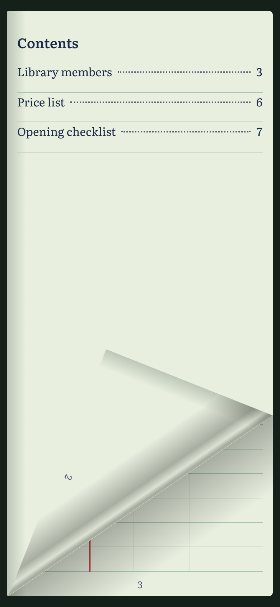
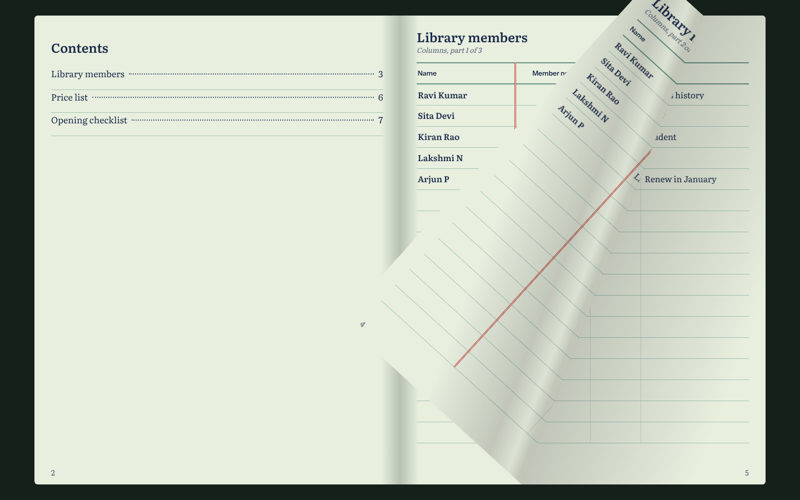
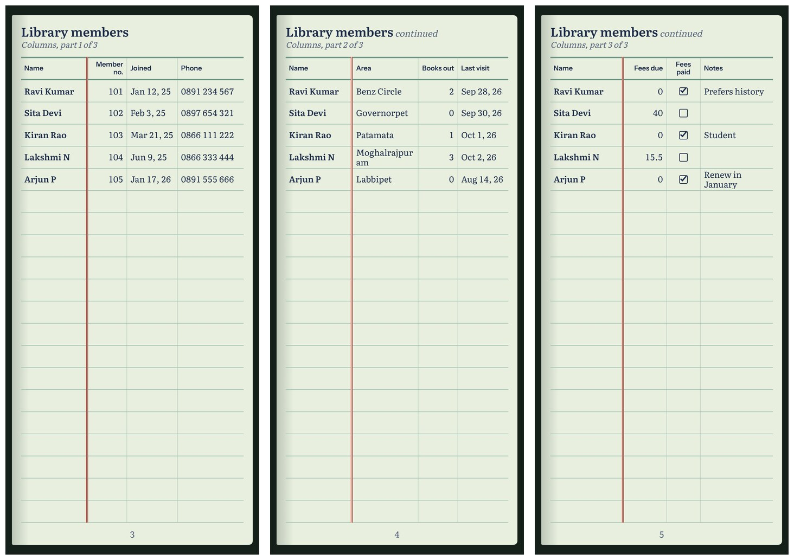

# Booklet View

A website where people keep tables (ledgers, price lists, checklists, task lists, anything) and read them as a **book** instead of a spreadsheet.

| A page being turned on a phone | A page being turned on a laptop |
|---|---|
|  |  |



- An **admin** creates the user accounts and can see and manage every book.
- Each **user** has their own private books. In a book they can add, rename, reorder and delete tables, columns and rows.
- Data is typed in or uploaded from an **Excel or CSV** file.
- A table that is too wide for one page continues on the next page, and the **first column is repeated** so the reader always knows which row they are on.
- Pages **turn like paper**: drag a page and it curls under the finger; swipe, tap an edge, or use the arrow keys.
- Delete is never on the normal view. It sits inside each item, asks for confirmation, and moves the item to a trash it can be restored from.

## Status

| Phase | What | State |
|---|---|---|
| 1 | Python backend: users, books, tables, columns, rows, Excel/CSV upload, booklet page layout | **Done** |
| 2 | Screens for signing in and editing tables | **Done** |
| 3 | Book view without animation (ledger look, cover, contents) | **Done** |
| 4 | Page-turning animation, on phones and laptops | **Done** |
| — | Ready to go live on a free plan (Render + Neon) | **Done** |
| 5 | Layout polish for laptop, desktop, iPad and phone | Next |
| 6 | Upload tables from Word and PDF | Planned |
| 7 | Upload photos of paper pages | Planned |

## Folders

```
Booklet view/
├── README.md          this file
├── CHANGELOG.md       every change, newest first
├── start.command      double-click on a Mac to set up and start everything
├── start-for-phone.command   the same, reachable from a phone on the same Wi-Fi
├── Dockerfile         builds the whole site into one container for the server
├── render.yaml        tells Render how to run it
├── documents/         a Word document for each discussion and each build step
├── python_code/       the Python (Django) backend
│   ├── manage.py
│   ├── requirements.txt
│   ├── booklet_site/  project settings and URL list
│   ├── accounts/      users, roles, sign-in
│   └── books/         books, tables, columns, rows, upload, booklet pages
└── frontend/          the screens (React)
    ├── package.json
    └── src/
        ├── pages/       SignIn, Books, Book, Reader, Trash, Users
        ├── components/  TableEditor, Dialog, Shell
        └── styles.css
```

## Run it

You need Python 3.10 or newer and Node.js 18 or newer.

### On a Mac: one double-click

Double-click `start.command` in Finder. The first time, it installs what the project needs (a few minutes, needs the internet) and asks you to create the admin account. Then it starts the backend and the screens and opens <http://localhost:5173>. Close the Terminal window to stop.

If macOS refuses to open it, right-click the file and choose Open, or run it from Terminal:

```bash
bash start.command
```

### On a phone

Run `start.command` once first. Then double-click `start-for-phone.command` instead. It prints an address such as `http://192.168.1.23:5173`; open that in the phone's browser. The phone must be on the same Wi-Fi as the Mac. While it runs, any device on that Wi-Fi can open the site, so use your own Wi-Fi, not a public one.

### By hand: two terminals

### Terminal 1: backend

**Mac or Linux**

```bash
cd python_code
python3 -m venv .venv
source .venv/bin/activate
pip install -r requirements.txt
python manage.py migrate
python manage.py createsuperuser
python manage.py seed_demo
python manage.py runserver
```

**Windows (PowerShell)**

```powershell
cd python_code
python -m venv .venv
.venv\Scripts\Activate.ps1
pip install -r requirements.txt
python manage.py migrate
python manage.py createsuperuser
python manage.py seed_demo
python manage.py runserver
```

- `createsuperuser` makes the first admin account.
- `seed_demo` is optional. It creates the user `demo` (password `demo-Booklet-2026`) with a sample book.
- After the first time, only the activate line and `runserver` are needed.

### Terminal 2: screens

```bash
cd frontend
npm install
npm run dev
```

Open <http://localhost:5173> and sign in.

To open the site from a phone when starting by hand, run `npm run dev:phone` instead and open the Network address it prints.

## Put it on the internet

The site runs as one service: the Python backend also serves the screens. The free setup is **Render** for the website and **Neon** for the PostgreSQL database.

1. Push this repository to GitHub.
2. On [neon.com](https://neon.com), create a project and copy its connection string (starts with `postgresql://`).
3. On [render.com](https://render.com), choose **New → Blueprint** and pick this repository. Render reads `render.yaml`.
4. Fill in the three values it asks for: `DATABASE_URL` (the Neon string), `BOOKLET_ADMIN_USERNAME` and `BOOKLET_ADMIN_PASSWORD` (the first admin of the live site).
5. Press Apply. When the build finishes, open the address Render shows and sign in.

On the free plan the site sleeps after 15 minutes without visitors and takes about a minute to wake. Every later push to GitHub is published automatically. The full walkthrough is in `documents/07-Going-Live.docx`.

## Run the tests

```bash
cd python_code
python manage.py test
```

## Documents

| Document | What it records |
|---|---|
| `01-Requirement-Discussion.docx` | The first discussion of the requirement |
| `02-Requirements-and-Decisions.docx` | Everything agreed before building |
| `03-Backend-Build-Notes.docx` | Phase 1: the backend and every API address |
| `04-Screens-and-Book-View.docx` | Phases 2 and 3: the screens and the book view |
| `05-Running-on-the-Mac.docx` | The Mac launcher, and what was checked on the Mac |
| `06-Testing-on-a-Phone.docx` | How to open the site on a phone, and what to try |
| `07-Going-Live.docx` | Putting the site on the internet: decisions, code changes, steps |
| `08-Page-Turning.docx` | Phase 4: the page-turning animation |

## Built with

Python, Django, Django REST Framework and openpyxl for the backend. React and Vite for the screens, with [StPageFlip](https://github.com/Nodlik/StPageFlip) for the page turn. SQLite for development and PostgreSQL for production. Gunicorn, WhiteNoise and Docker on the server.
